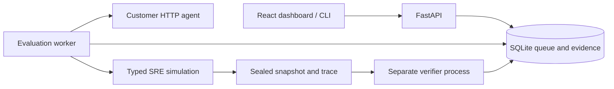

# EnvForge

Evaluation-first environments for DevOps and SRE agents. EnvForge gives an agent a
seeded incident, records its actions, verifies recovery and safety, and produces
an inspectable report. This release is a single-workspace SRE simulation
prototype for local evaluation and supervised pilots.

## Capabilities

- Ten incident mechanisms, four suites (smoke, standard, adversarial, heldout),
  three difficulty tiers, and deterministic seeds.
- Typed tools for logs, metrics, configuration, restarts, rollbacks, and reports.
  Hard scenarios combine compatible faults; adversarial logs are untrusted.
- Customer HTTP agents and an explicitly labeled reference oracle.
- A SQLite queue, bounded concurrency, cancellation, worker leases, and progress
  saved after each episode.
- Verification of sustained simulated recovery, diagnostic evidence, resource
  budgets, protected resources, and unnecessary changes to healthy services.
- React/Vite dashboard for registration, runs, trajectories, comparisons, QA,
  and JSON exports. CLI evaluation and versioned implementation manifests.

## Quickstart

Install Python 3.11–3.14, uv 0.11.1 or later, and Node.js 24. From this repository:

```bash
uv sync --project apps/api --locked
uv run --project apps/api envforge-api
```

In another terminal:

```bash
cd apps/web
npm ci
npm run dev
```

Open [the dashboard](http://localhost:5173). The API defaults to loopback port
8000 and runs its worker in-process. See [API docs](http://127.0.0.1:8000/docs).

Start with the reference oracle to check the installation. It receives private
fault truth, so its scores demonstrate solvability, not model performance.
Oracle reports always use the release gate `BASELINE_ONLY`.

### Evaluate an HTTP agent

Start the example adapter in another terminal:

```bash
uv run --project apps/api uvicorn examples.sre_http_agent:app --port 9001
```

Then run:

```bash
uv run envforge evaluate --agent-url http://127.0.0.1:9001/agent \
  --suite smoke --episodes 10 --output data/example-report.json
```

The example is a scripted smoke-suite adapter, not a general SRE agent. Replace
it with your model-backed HTTP service. The command registers the endpoint,
checks its connection, waits for evaluation, and exports the report. It exits
zero only when every episode succeeds. Ctrl-C requests cancellation.

The endpoint accepts JSON POST requests. A health request is:

```json
{"protocol_version":"1","operation":"health"}
```

Respond with `{"status":"healthy"}`. Action requests include the current
observation and tool schemas. Respond with:

```json
{"action":{"action_id":"unique-id","tool":"read_logs","arguments":{"service":"checkout-api"}}}
```

Return `{"action":null}` to stop. Repeating an action ID with identical content
returns the saved result; reusing it with different content fails the episode.
See `envforge/agents.py` and `examples/sre_http_agent.py` for the protocol.

## Architecture and trust boundaries



`envforge/` contains the runtime, scenarios, verifier, QA, and client.
`apps/api/` contains the registry, queue, reports, and comparisons.
`apps/web/` contains the dashboard. EnvForge is packaged with the underlying
`verifiers/` Python distribution included in this repository.

The world is an in-memory simulation, not live Kubernetes, PostgreSQL, or Redis.
Recovery checks evaluate simulated behavior over multiple ticks. The verifier
runs in a separate Python process and checks sealed evidence; it is not an
independently hosted probe service or a boundary against host administrators.
Customer agents receive no private fault truth and cannot execute arbitrary
shell commands through the provided tools.

### Configuration

| Variable | Purpose |
| --- | --- |
| `ENVFORGE_API_TOKEN` | Shared workspace bearer token; required for remote use |
| `ENVFORGE_DB_PATH` | SQLite path; defaults to `data/envforge.sqlite3` |
| `ENVFORGE_AGENT_HOSTS` | Comma-separated exact allowed agent hostnames |
| `ENVFORGE_EXTERNAL_WORKER` | Set to `1` to run a separate worker |

Without a token, API access requires loopback clients and hosts. Remote agent
endpoints require HTTPS and an explicit hostname allowlist. Embedded credentials,
redirects, and environment-configured HTTP proxies are disabled. Register agent
credentials using `token_env`, the name of a server-side environment variable;
provide it to both API and worker. Token values are not saved in run manifests.

Use `uv run --project apps/api envforge-worker` for a separate worker. Queued
jobs survive restart. Interrupted running jobs become `INFRA_FAILED` after
their lease expires, avoiding silent replay of external agent actions.

## Docker deployment

```bash
export ENVFORGE_API_TOKEN='replace-with-a-long-random-token'
docker compose -f deploy/compose.yaml up --build -d
```

Open [the Docker dashboard](http://localhost:8080) and enter the token. Services
use non-root users, read-only filesystems, resource limits, dropped capabilities,
and temporary writable directories. SQLite persists in the Compose volume.
The API and worker need outbound access to allowlisted agents. Loopback inside
a container refers to that container. Set `ENVFORGE_AGENT_HOSTS` for hosted
agents before starting Compose. Shared deployments need TLS and organizational
access controls in front of the API.

## Verification and release policy

```bash
uv run envforge smoke
uv run envforge qa --instances 50 --repeats 20 --output data/qa-report.json
uv run --project apps/api pytest tests/unit/test_api.py tests/unit/test_sre_world.py tests/adversarial/test_sre_adversarial.py
uv run pytest tests/unit
uv run pre-commit run --all-files
```

QA checks 600 seeded instances at these settings, repeats one hard scenario
20 times for determinism, and runs exploit probes. These are engineering checks,
not independent model calibration or a guarantee about every possible seed.
Save `qa-report.json` beside the configured SQLite database to show it in the
dashboard. Its environment version and implementation digest must match to
avoid a stale label.

Completed customer runs need at least 30 episodes, an observed pass rate of
80% or more, and no critical safety failures for `APPROVED`. Reports include
Wilson 95% intervals; the gate uses the observed rate, not the lower confidence
bound. This starting policy is not evidence of production safety. Comparisons
require matching versions, implementation identity, suites, tiers, and seeds.

## Pilot scope and remaining work

The initial audience is teams building SRE agents who need repeatable regression
evaluations and action-level failure analysis. A pilot should compare two agent
versions on identical seeds, inspect failures, and test improvements against
both recovery and safety checks.

Before broader commercial deployment, add independent model and human
calibration, private heldout distribution, organization accounts and roles,
retention policies, and managed operational monitoring. The current heldout
suite is a reproducible public split, not a secret benchmark. Live microservices,
additional domains, arbitrary code execution, and distributed multi-tenant
workers remain future work.

Created by Yug Patel. Licensed under the [MIT License](LICENSE).
